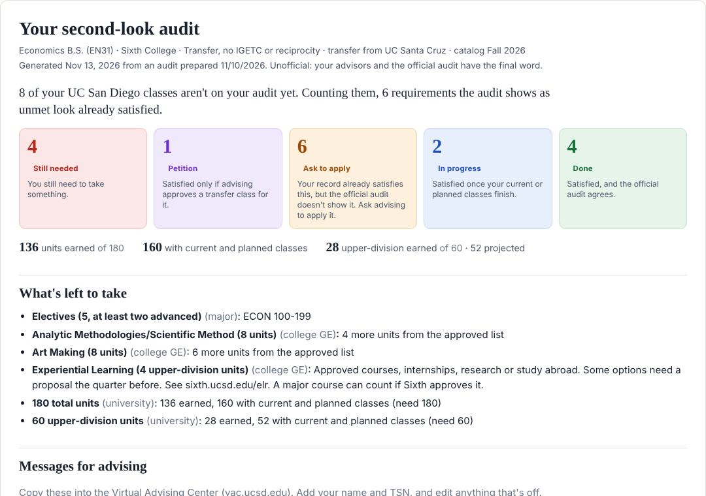

# Re-Audit

**An unofficial second look at your UC San Diego degree audit.**

👉 **Use it here: https://reaudit.net** — nothing to install, and your files never leave your computer.

Re-Audit is an unofficial companion to your TSS degree audit. It combines your audit with your academic history, lines up every class on your record against your major, college and university requirements (including classes that haven't been applied to a requirement yet), shows what you still need, and turns anything unclear into a specific, ready-to-send question for advising.



## How to use it

1. **Save your audit as a PDF.** In TSS, run your Degree Audit, click **Open All Sections**, print it (⌘/Ctrl+P), and choose **Save as PDF**.
2. **Copy your academic history.** In TSS, open **My Academic History**, press ⌘/Ctrl+A, then ⌘/Ctrl+C.
3. **Open Re-Audit**, drop in the PDF, paste the history, and click **Check my audit**.

Want to see it first? Click **Try it with sample data** (a made-up student).

You get every requirement marked with one of these:

| Status | Meaning |
| --- | --- |
| **Done** | Satisfied, and the official audit agrees |
| **In progress** | Satisfied once your current or planned classes finish |
| **Ask to apply** | Classes already on your record satisfy it, but the official audit doesn't show it |
| **Petition** | Satisfied only if advising approves a transfer class for it |
| **Still needed** | You still need to take something |

Plus a "what's left to take" list, copy-ready messages for your college and major advisors, a table of every class and where it lands, and a printable version.

## How it works

There's no AI involved. It's ordinary code following written-down rules, so the same audit always gives the same answer, and every result traces back to a rule with a source.

1. **It reads your audit PDF.** The text is pulled out in your browser with [pdf.js](https://mozilla.github.io/pdf.js/). Re-Audit finds each requirement, notices whether it has a `NEEDS:` line (meaning the audit shows it as unmet), and collects every class line: term, course, units, grade. Transfer grades carry a prefix: `TB-` means TSS matched the class to a UC San Diego course; `tA-` means it's still under the other school's code, so UC Santa Cruz's CSE 20 never gets mistaken for UC San Diego's CSE 20.
2. **It reads your academic history.** From the TSS paste it picks up each term, grade and grading option, withdrawals and retakes (a retake replaces a D or F), your previous school, and whether ELWR and AHI are done. Then it merges this with the audit so nothing is counted twice. This way every class on your record is included, even ones not yet applied on the audit.
3. **It looks up the rules.** Requirements live in plain files in [`rules/`](rules/), written from the General Catalog, college GE lists and the Academic Senate's DEI list, each with its source.
4. **It places your classes.** Like a puzzle: every requirement has slots, and within the major (or within the college) one class fills only one slot. Re-Audit finds the arrangement that fills the most slots, so a class never gets used up somewhere it had alternatives while another requirement goes empty. Finished classes are preferred over current ones, and current ones over petitions. Major and GE requirements can share a class.
5. **It compares with the official audit.** If your classes satisfy something the audit shows as unmet, that's **Ask to apply**. If it only works with a transfer petition, that's **Petition**. If nothing on your record fits, it's **Still needed**, with what would fill it. And if TSS says something is met that Re-Audit can't see (AP credit, say), it trusts TSS.
6. **It writes the report and the advising messages** from those results.

Transfer classes without a UC San Diego equivalent go through a small table per school ([`rules/transfer/`](rules/transfer/)) that says where each one likely fits and why. A person decides that once, and it then works the same way for everyone from that school.

## Privacy

Your audit and academic history are read in your browser and never uploaded. There's no server and no account, and the page's content security policy blocks connections to anything other than the site itself. You can confirm that in your browser's network tab.

The site counts visits with [Cloudflare Web Analytics](https://www.cloudflare.com/web-analytics/), which uses no cookies and doesn't track people across sites. It sees that a page was visited, never what you upload or paste.

## What it covers so far

- **Majors (23):**
  - Engineering and computing: Computer Science B.S. (CS26), Computer Engineering B.S. (CS25), Electrical Engineering B.S. (EC27), Mechanical Engineering B.S. (MC27), Data Science B.S. (DS25)
  - Math: Applied Mathematics B.S. (MA27), Mathematics–Computer Science B.S. (MA30), Probability and Statistics B.S. (MA35)
  - Biology: General Biology B.S. (BI31), Human Biology B.S. (BI35), Molecular and Cell Biology B.S. (BI37), Neurobiology B.S. (BI38)
  - Cognitive Science and Psychology: Cognitive Science B.A. (CG25), Cognitive Science B.S., Design and Interaction (CG33), Cognitive Science B.S., Machine Learning and Neural Computation (CG35), Psychology B.A. (PC25), Business Psychology B.S. (PC35)
  - Economics and social sciences: Economics B.A. (EN25), Economics B.S. (EN31), Business Economics B.S. (EN30), Political Science B.A. (PS25), Communication B.A. (CM26), Sociology B.A. (SO25)
- **Colleges:** Sixth College GEs (first-year, general transfer, and IGETC/reciprocity)
- **University:** ELWR, AHI, DEI, 180 units, 60 upper-division units, the 25% P/NP limit
- **Transfer tables:** UC Santa Cruz

If your major or college isn't listed, Re-Audit still checks everything else and tells you what it skipped. Adding one is mostly copying course lists into a file. See [CONTRIBUTING.md](CONTRIBUTING.md).

## Limitations

- It's only as good as the rule files. Course lists change by catalog year; each file says which year it was checked against.
- Experiential Learning, exam credit, senior residence and approved substitutions can't be seen from a course list. When the official audit says something is met, Re-Audit trusts it.
- Petition suggestions are reasonable based on the course description, not a promise.
- The major GPA shown is an estimate. Your official GPA is in TSS.

Your advisors and the official audit have the final word.

## Run your own copy

It's plain HTML and JavaScript with no build step. Browsers won't load the rule files from `file://`, so serve the folder:

```sh
git clone https://github.com/Prabhjas12/re-audit.git
cd re-audit
python3 -m http.server 8000      # then open http://localhost:8000
```

Or use the command-line version, which writes the same report as an HTML file:

```sh
npm install
node tools/re-audit.mjs --audit "My Audit.pdf" --history history.txt --out report.html
```

To host your own copy, fork the repo and set **Settings → Pages → Source** to **GitHub Actions**. The workflow in `.github/workflows/deploy.yml` runs the tests and publishes only the website files.

## Development

```sh
npm install
npm test              # parser, engine, every major, and end-to-end tests
npm run check-rules   # validates every rule file
```

Never commit a real audit or academic history. `.gitignore` blocks PDFs for this reason; tests use made-up students.

## License

MIT. Includes [pdf.js](https://github.com/mozilla/pdf.js) (Apache-2.0) in `vendor/pdfjs/`.

Re-Audit is a student project. It is not affiliated with or endorsed by UC San Diego.
